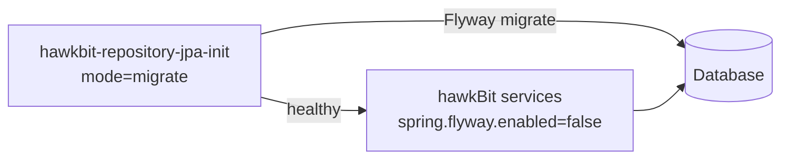

# Database Setup

hawkBit stores its repository (targets, distribution sets, software modules, rollouts, actions, ...) in a relational
database accessed via JPA. This page describes which databases are supported, how to connect hawkBit to them and how
the database schema is created and migrated.

For a complete production-like setup (database, RabbitMQ, artifact storage) see [Base Setup](base-setup.md).

---

### Supported databases

| Database        | `spring.jpa.database` | Use                                              |
|-----------------|-----------------------|--------------------------------------------------|
| H2 (in-memory)  | `H2`                  | default - development, evaluation and tests only |
| MariaDB / MySQL | `MYSQL`               | production                                       |
| PostgreSQL      | `POSTGRESQL`          | production                                       |

Without any configuration hawkBit starts with an in-memory H2 database (`jdbc:h2:mem:hawkbit`). All data is lost when
the server stops.

The servers (update server, mgmt, DDI and DMF servers) contain the H2, MariaDB and PostgreSQL JDBC drivers.

---

### Connect to MariaDB / MySQL or PostgreSQL

Each server ships with two Spring profiles with settings for a local database:

| Profile      | File                                | Defaults                                                                      |
|--------------|-------------------------------------|-------------------------------------------------------------------------------|
| `mysql`      | `application-mysql.properties`      | `jdbc:mariadb://localhost:3306/hawkbit`, user `root`, empty password          |
| `postgresql` | `application-postgresql.properties` | `jdbc:postgresql://localhost:5432/hawkbit`, user `postgres`, password `admin` |

Activate a profile and override what differs in your environment:

```bash
$ java -jar hawkbit-update-server.jar --spring.profiles.active=postgresql \
    --spring.datasource.url=jdbc:postgresql://db-host:5432/hawkbit \
    --spring.datasource.username=hawkbit \
    --spring.datasource.password=secret
```

Or configure the connection directly, e.g. for PostgreSQL:

```properties
spring.jpa.database=POSTGRESQL
spring.datasource.url=jdbc:postgresql://localhost:5432/hawkbit
spring.datasource.username=postgres
spring.datasource.password=admin
spring.datasource.driverClassName=org.postgresql.Driver
```

For MariaDB / MySQL use `spring.jpa.database=MYSQL` and the `org.mariadb.jdbc.Driver` driver. `spring.jpa.database`
must always match the database - it also selects the schema migration scripts (see below).

---

### Schema creation and migration

The database schema is managed with [Flyway](https://www.flywaydb.org/). The migration scripts are part of the
`hawkbit-repository-jpa-flyway` module, one set per database. The applied migrations are recorded in the table
`schema_version`. Flyway `clean` is disabled.

There are two ways to apply the migrations.

#### Option 1: automatically at server start (default)

The update server (monolith) and the mgmt server contain `hawkbit-repository-jpa-flyway`. On start they create the
schema in an empty database or migrate an existing schema to the current version. Nothing has to be configured.

The DDI and DMF servers do not contain the migration scripts. In a micro-service deployment the mgmt server (or the
standalone initializer, see below) has to migrate the database first.

#### Option 2: standalone database initializer

If you want to manage the schema separately from the running services - e.g. only on real updates, from a pipeline, or
with a database user that has more permissions than the services - use the standalone initializer
`hawkbit-repository-jpa-init` (main class `HawkbitFlywayDbInit`). It has two modes:

- `validate` (default) - checks that the schema matches the current hawkBit version; exit code `2` if it does not
- `migrate` - creates / migrates the schema

It is configured with `hawkbit.db.<key>` or `spring.datasource.<key>` environment or system properties (`mode`, `url`,
`username`, `password`, ...):

```bash
$ export HAWKBIT_DB_MODE=migrate
$ export HAWKBIT_DB_URL=jdbc:mariadb://localhost:3306/hawkbit
$ export HAWKBIT_DB_USERNAME=root
$ java -jar hawkbit-repository-jpa-init-<version>.jar
```

Then disable the migration in the services:

```properties
spring.flyway.enabled=false
```

The initializer is also available as Docker image `hawkbit/hawkbit-repository-jpa-init` (built from
`docker/build/Dockerfile_dbinit`). The `*-dbinit-*` compose files in `docker/mysql` and `docker/postgres` show the
setup - the initializer migrates the database and the hawkBit services start afterwards with
`SPRING_FLYWAY_ENABLED=false`:

```bash
$ cd hawkbit/docker
$ docker compose -f postgres/docker-compose-monolith-dbinit-postgres.yml up -d
```



More details:
[hawkbit-repository-jpa-init](https://github.com/eclipse-hawkbit/hawkbit/tree/master/hawkbit-repository/hawkbit-repository-jpa-init).

---

### Choosing the JPA vendor

hawkBit supports two JPA implementations:

- [EclipseLink](https://eclipse.dev/eclipselink/) - default
- [Hibernate](https://hibernate.org/)

The JPA vendor is chosen at **build time**, because the entity classes are enhanced (EclipseLink static weaving or
Hibernate bytecode enhancement) during the build. To build hawkBit with Hibernate:

```bash
$ mvn clean install -Djpa.vendor=hibernate
```

The database schema and the migration scripts are the same for both vendors.
