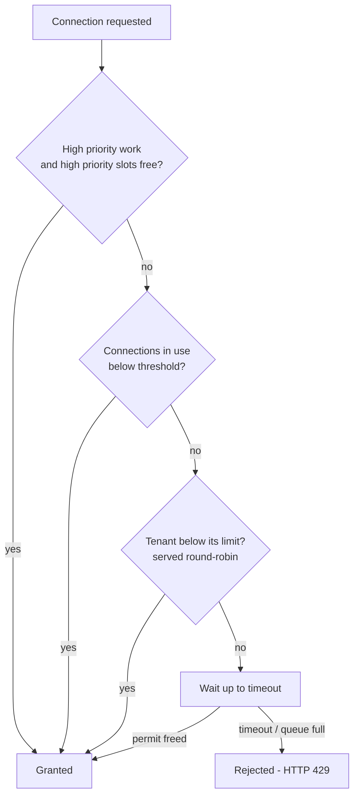

# Throttling

hawkBit has two independent mechanisms to protect itself from overload:

- **DoS filter** - limits the number of REST requests per second per client IP address. Enabled by default.
- **Tenant throttling** - limits how many database connections a single tenant may hold at the same time, so that one
  busy tenant can't take the whole connection pool. Disabled by default.

Both reject requests with HTTP `429 Too Many Requests`. Both work per node - in a cluster each node counts on its own
(see [Clustering](clustering.md)).

---

### DoS filter

The DoS filter counts the requests of every client IP address within one-second windows, separately for read (`GET`)
and write (all other methods) requests. A client above the limit gets `429` (with `Retry-After: 1`) until the window
expires. The limits can be set per API, by default all use the global ones:

- the Management API (`/{tenant}/rest/**` and `/rest/**`) (mgmt server / update server) - `mgmt`
- the DDI API (`/{tenant}/controller/v1/**`) (DDI server / update server) - `ddi`
- the DDI artifact download - `ddi-download` (not counted by the DDI API limits)
- `/system/*` - `system`

The filter runs before the authentication, so requests with invalid credentials are throttled too, and rejected requests
don't reach the authentication (e.g. DDI target token lookups in the database). Additionally, it counts the failed
authentications (`401`) per client IP: above `max-auth-failures` per second the requests of the client IP are rejected
without authentication. Devices with valid credentials don't count there - so many devices behind one IP (e.g. a mobile
gateway / NAT) aren't limited by it, while clients with wrong credentials are.

Limits:

- the failed authentication limit is approximate under concurrency - the failures are counted when the request
  completes, so the requests already in flight when the limit is reached still pass (e.g. with slow password hashing
  somewhat more attempts per second than `max-auth-failures` are possible - the read / write limits still cap them)
- IPv6 clients are counted per address - a client controlling a whole IPv6 prefix (e.g. `/64`) could rotate its source
  addresses. If needed, the reverse proxy / network shall limit such clients

The first rejected request of a window is logged (by the security logger, with the tenant and forwarded for - as in the
[load report](#load-report)).

| Property                                                          | Default                 | Description                                                       |
|-------------------------------------------------------------------|-------------------------|-------------------------------------------------------------------|
| `hawkbit.server.security.dos.filter.enabled`                      | `true`                  | enables the DoS filter                                            |
| `hawkbit.server.security.dos.filter.max-read`                     | `200`                   | max read (`GET`) requests per second per client IP                |
| `hawkbit.server.security.dos.filter.max-write`                    | `50`                    | max write requests per second per client IP                       |
| `hawkbit.server.security.dos.filter.<api>.max-read` / `max-write` | global                  | per API limits, `<api>` = `mgmt`, `ddi`, `ddi-download`, `system` |
| `hawkbit.server.security.dos.filter.max-auth-failures`            | `10`                    | max failed authentications per second per client IP, `0` = off    |
| `hawkbit.server.security.dos.filter.whitelist`                    | private / loopback IPv4 | IPs (regex) which are not limited per IP                          |
| `hawkbit.server.security.dos.filter.report-percent`               | `20`                    | load report threshold - percent of the limits, `0` = off          |
| `hawkbit.server.security.dos.filter.report-interval`              | `1h`                    | load report interval                                              |
| `hawkbit.server.security.clients.blacklist`                       | empty                   | IPs (regex) which are always rejected with `403`                  |

- clients matching the blacklist are rejected with `403 Forbidden`, clients matching the whitelist aren't limited (nor
  reported). The IPs are matched without brackets (IPv6 e.g. `0:0:0:0:0:0:0:1`). The patterns are searched in the IP
  (not matched against the whole IP) - anchor them (e.g. `^10\.`), otherwise `10\.` matches `110.1.2.3` too. The
  default whitelist is anchored
- a client IP resolved behind a proxy of a tenant (see [Client IP](#client-ip)) is never whitelisted, and is counted
  (requests, failed authentications, load report) per tenant and IP - since customers' (private) networks overlap. It is
  logged as `<tenant>/<ip>`
- if the client IP can't be determined the request fails with `500`

Usually DoS protection is an infrastructure topic (e.g. a Web Application Firewall). The filter could be disabled with
`hawkbit.server.security.dos.filter.enabled=false` when such protection is in place.

> The other `hawkbit.server.security.dos.*` properties (e.g. `max-artifact-size`, `max-targets-per-rollout-group`) are
> not request limits but repository quotas.

#### Client IP

The client IP is used by the DoS filter and stored as target address (see
`hawkbit.server.security.clients.track-remote-ip`).

hawkBit runs behind a reverse proxy. With `server.forward-headers-strategy=NONE` (the default, set by the hawkBit REST
starters) hawkBit processes the forwarded headers itself - with embedded Tomcat as a valve (so the access log and the
error pages see the resolved values too), with other servlet containers (e.g. Jetty) as a servlet filter:

- the client IP is resolved from `hawkbit.server.security.clients.remote-ip-header` (default `X-Forwarded-For`)
  processing it right to left: the trusted proxies are skipped, the
  first not trusted address is the client IP. A proxy appends the address it got the request from, so the values a
  client sends by itself can't be used to spoof its IP. A proxy with a public IP has to be configured as trusted,
  otherwise all requests through it get the proxy IP
- `X-Forwarded-Proto` / `-Host` / `-Port` (used for generated links) are applied only if the connection peer is a
  (globally) trusted proxy. They are single values, so the proxy must set (overwrite) them
- redirects are relative (`server.tomcat.use-relative-redirects=true`), so they don't contain the request host. With the
  servlet filter, absolute redirects are corrected to the forwarded scheme / host / port
- with the servlet filter the container itself doesn't see the resolved values (e.g. container access log, cookie
  `Secure` flag - set `server.servlet.session.cookie.secure=true` if needed)

Trusting a proxy globally trusts it for all tenants and APIs - its `X-Forwarded-For` values could be used to bypass the
limits. A proxy (or NAT) of a tenant's devices (e.g. of the customer) shares its IP between all devices behind it, so
they share the limits of a single client. Such a proxy could be trusted just for the tenant's DDI requests
(`/{tenant}/controller/**`, including the artifact download; tenant from the path, case-insensitive) with
`hawkbit.server.security.forwarded.tenants.<tenant>`: for them the client IP resolution continues past the tenant's
trusted proxies, so the devices are resolved (DoS limited, failed authentications counted, target address tracked) by
their own IPs. Left of a tenant's proxy only the tenant's trusted proxies are skipped - not the global ones (e.g. the
private ranges): they describe hawkBit's own network, while left of a customer proxy the private IPs belong to the
customer (e.g. the devices). So a customer with internal proxies behind its edge proxy lists them too. The other tenants
and APIs don't trust them, and `X-Forwarded-Proto` / `-Host` / `-Port` are applied only from globally trusted peers.
The tenant is from the not yet authenticated path - fine, since only requests coming through the tenant's proxies are
affected. To find such proxies see the [load report](#load-report).

The remote IP header values (hops) and the connection peer are normalized: the port (`IPv4:port`, `[IPv6]:port`) and the
IPv6 brackets are removed, an IPv4-mapped IPv6 address (`::ffff:1.2.3.4`, e.g. from dual-stack proxies) is used as IPv4,
IPv6 in full form (e.g. `2001:db8:0:0:0:0:0:1`, as the servlet container reports the peer). The whitelist / blacklist
regular expressions and the logs see this form. A value which is not an IP literal ends the chain - the values left to
it are ignored.

| Property                                             | Default                   | Description                                                            |
|------------------------------------------------------|---------------------------|------------------------------------------------------------------------|
| `server.forward-headers-strategy`                    | `NONE`                    | `NONE` - hawkBit processes the forwarded headers                       |
| `hawkbit.server.security.clients.remote-ip-header`   | `X-Forwarded-For`         | header containing the client IP chain (both modes)                     |
| `hawkbit.server.security.forwarded.trusted-proxies`  | default ranges (below)    | trusted proxies - comma separated IPs / CIDR blocks                    |
| `hawkbit.server.security.forwarded.tenants.<tenant>` | none                      | trusted proxies for the DDI requests of the tenant - IPs / CIDR blocks |
| `hawkbit.server.security.forwarded.protocol-header`  | `X-Forwarded-Proto`       | header containing the original scheme                                  |
| `hawkbit.server.security.forwarded.host-header`      | `X-Forwarded-Host`        | header containing the original host                                    |
| `hawkbit.server.security.forwarded.port-header`      | `X-Forwarded-Port`        | header containing the original port                                    |
| `server.tomcat.use-relative-redirects`               | `true`                    | relative redirects                                                     |

The default trusted proxies are the private, loopback, link-local and CGNAT ranges (IPv4 and IPv6): `10.0.0.0/8`,
`192.168.0.0/16`, `169.254.0.0/16`, `127.0.0.0/8`, `100.64.0.0/10`, `172.16.0.0/12`, `::1/128`, `fe80::/10`,
`fc00::/7`. `trusted-proxies` not set - the defaults, set but empty - nothing trusted. Setting it replaces the defaults,
so list all proxies.

With another forward headers strategy (e.g. `NATIVE`, `FRAMEWORK`) hawkBit logs a warning at startup and works in
legacy mode: the client IP is read as is from `hawkbit.server.security.clients.remote-ip-header` - the first IPv4
address found in it (IPv6 only in full, uncompressed form), if any, otherwise the remote address of the connection.
The users are responsible to ensure correct forwarded headers (e.g. the proxy sets / overwrites `X-Forwarded-For`) and
redirect behavior.

Example - stricter limits, and a customer edge proxy (with an internal proxy behind it) trusted for its tenant. The
reverse proxy is in a private network - trusted by default, so `trusted-proxies` isn't set:

```properties
hawkbit.server.security.dos.filter.max-read=50
hawkbit.server.security.dos.filter.max-write=10
hawkbit.server.security.forwarded.tenants.acme=198.51.100.7, 10.20.0.5
```

##### Upgrade from 1.2.0

hawkBit now processes the forwarded headers itself (default strategy `NONE`):

- remove `server.forward-headers-strategy=NATIVE` if set (recommended by the 1.2.0 reverse proxy docs) - otherwise
  hawkBit runs in legacy mode (the client IP read from the header as is, as in 1.2.0) and logs a warning
- `server.tomcat.remoteip.*` properties are not used (a startup warning lists them if set) - configure
  `hawkbit.server.security.forwarded.trusted-proxies` and `hawkbit.server.security.clients.remote-ip-header` instead
- if the reverse proxy reaches hawkBit from a public (not default trusted) address, add it to
  `hawkbit.server.security.forwarded.trusted-proxies` - otherwise all clients get the proxy IP (and share its DoS
  limits)

#### Load report

The DoS filter logs (by the security logger) the client IPs reaching `report-percent` of their read or write limit (per
API) in a one-second window:

- the first time in a report interval immediately -
  `[DOS] High load! Client <ip> reached <n> READ|WRITE requests per second (limit <l>) - tenant <tenant>, forwarded for [<hops>]`
- at the end of the interval (reported with the next high load request after it) all client IPs of the interval with
  their peak read / write rates (`[DOS] Load report: ...`). Then they are reset - so they are logged as new again. Max
  1000 client IPs per interval, the others are just counted

The tenant is the one of the DDI path (not authenticated), forwarded for - the up to 5 `X-Forwarded-For` hops nearest to
the client IP, as claimed by it (not verifiable). A client IP with forwarded for hops is a proxy - it could be trusted
for its tenant (`hawkbit.server.security.forwarded.tenants.<tenant>`) or globally. Without - e.g. a
NAT - it could be whitelisted, or the limits raised.

---

### Tenant throttling

When enabled, every database connection taken from the pool needs a permit. A permit is charged to the tenant of the
current request. The number of permits (the capacity) equals the connection pool size, so the throttle is the only
queue in front of the pool.

When no permit is available, the request waits up to `hawkbit.throttle.timeout`. If it still gets none, it fails with
HTTP `429`. With timeout `0` (default) the request is rejected immediately.

#### How permits are granted



- **Threshold** - while fewer connections than `threshold` are in use, any tenant may use free connections (burst).
  At or above the threshold, each tenant is capped by its `limit` and waiting tenants are served round-robin (A, B, A,
  B, ...) rather than first-come-first-served. With `threshold <= 0` (default) the tenant limit is always enforced.
- **Nested connections** - a request that already holds a connection and needs another one is always served first, to
  avoid deadlocks.
- **Pending requests** - `max-pending` bounds the number of waiting requests over all tenants (per tenant via
  `tenants.<tenant>.max-pending`). On overflow the oldest waiter of the longest queue is dropped, so a tenant flooding
  the queue pays for it, not a quiet one.

#### High priority work

Work the server does on its own has high priority:

- internal work without a tenant (e.g. database migration, health checks)
- the schedulers working for a tenant - rollout handling, auto assignment and auto cleanup

High priority connections are **not counted to the tenant limit** - they are counted to a separate high priority
count. Up to `high-priority-granted` connections, high priority work is served ahead of all waiting tenant requests.
Above that, it waits for its turn as one more participant in the round-robin, using the global `timeout`. No capacity is
reserved - tenants use these slots freely while no high priority work needs them. `high-priority-granted` must be lower
than the capacity, otherwise tenant requests may never be served (a warning is logged).

#### Properties

| Property                                        | Default          | Description                                                                                |
|-------------------------------------------------|------------------|--------------------------------------------------------------------------------------------|
| `hawkbit.throttle.enabled`                      | `false`          | enables tenant throttling                                                                  |
| `hawkbit.throttle.capacity`                     | `-1`             | total permits; `-1` = the Hikari `maximumPoolSize` (fallback `10` if it can't be detected) |
| `hawkbit.throttle.limit`                        | `-1`             | max concurrent connections per tenant; `-1` = no limit (capacity)                          |
| `hawkbit.throttle.timeout`                      | `0`              | max wait for a permit; `0` = reject immediately                                            |
| `hawkbit.throttle.max-pending`                  | `-1`             | max waiting requests over all tenants; `-1` = no limit                                     |
| `hawkbit.throttle.threshold`                    | `-1`             | connections in use from which the tenant limit applies; `<= 0` = always apply              |
| `hawkbit.throttle.high-priority-granted`        | `4`              | connections served ahead to high priority work; `0` = no serving ahead                     |
| `hawkbit.throttle.tenants.<tenant>.limit`       | `-1`             | per tenant limit override; `-1` = capacity, `0` = tenant blocked                           |
| `hawkbit.throttle.tenants.<tenant>.timeout`     | global `timeout` | per tenant timeout override                                                                |
| `hawkbit.throttle.tenants.<tenant>.max-pending` | `-1`             | max waiting requests of the tenant; `-1` = only the global bound                           |

Tenant names in `tenants.<tenant>` are case-insensitive.

#### Examples

Hard cap - each tenant at most 5 connections, reject immediately:

```properties
hawkbit.throttle.enabled=true
hawkbit.throttle.limit=5
hawkbit.throttle.timeout=0
```

Burst allowance with fairness under contention:

```properties
hawkbit.throttle.enabled=true
# max 10 connections per tenant when the pool is busy
hawkbit.throttle.limit=10
# wait up to 20s before HTTP 429
hawkbit.throttle.timeout=20s
# bound the waiting (blocked) threads over all tenants
hawkbit.throttle.max-pending=190
# fairness starts when 7 connections are in use
hawkbit.throttle.threshold=7
# a big tenant gets more
hawkbit.throttle.tenants.big-tenant.limit=20
```

#### Metrics

With Micrometer available:

- `hawkbit.throttle.connections.acquire` (timer, tag `tenant`) - time to get a connection, including waiting for a
  permit
- `hawkbit.throttle.connections.rejected` (counter, tags `tenant`, `reason`, `priority`) - rejected requests; `reason`
  is one of `BLOCKED`, `LIMIT`, `FAST_REJECT`, `DEADLOCK`, `KEY_QUEUE_FULL`, `QUEUE_FULL`, `EVICTED`, `TIMEOUT`
- `hawkbit.throttle.connections.usage` (timer, tags `tenant`, `priority`) - how long a connection was held
- `hawkbit.throttle.connections.active` (gauge, tag `priority`) / `hawkbit.throttle.connections.pending` (gauge) -
  connections held / requests waiting for a permit
