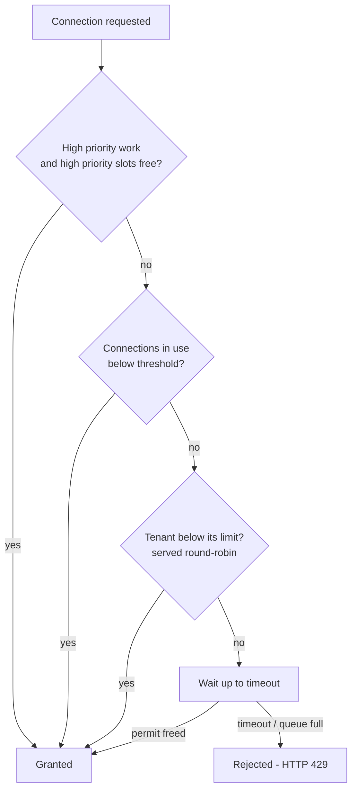

# Throttling

hawkBit has two independent mechanisms to protect itself from overload:

- **DoS filter** - limits the number of REST requests per second per client IP address. Enabled by default.
- **Tenant throttling** - limits how many database connections a single tenant may hold at the same time, so that one
  busy tenant can't take the whole connection pool. Disabled by default.

Both reject requests with HTTP `429 Too Many Requests`. Both work per node - in a cluster each node counts on its own
(see [Clustering](clustering.md)).

---

### DoS filter

The DoS filter counts the requests of every client IP address within one-second windows, separately for read (`GET`)
and write (all other methods) requests. A client above the limit gets `429` until the window expires.

It is applied to:

- the Management API (`/rest/*`) and `/system/admin/*` (mgmt server / update server)
- the DDI API (`/{tenant}/controller/v1/**`) and the DDI artifact download (DDI server / update server)
- `/system/*`

How the client IP is determined:

- from the header `hawkbit.server.security.clients.remote-ip-header` (default `X-Forwarded-For`) if present, otherwise
  from the remote address of the connection
- clients matching `hawkbit.server.security.clients.blacklist` (regular expression) are rejected with `403 Forbidden`
- clients matching `hawkbit.server.security.dos.filter.whitelist` (regular expression) are not limited. The default
  whitelist contains the private and loopback address ranges (`10.*`, `192.168.*`, `172.16-31.*`, `169.254.*`, `127.*`)
- if the client IP can't be determined the request fails with `500`

| Property                                           | Default                       | Description                                              |
|----------------------------------------------------|-------------------------------|----------------------------------------------------------|
| `hawkbit.server.security.dos.filter.enabled`       | `true`                        | enables the DoS filter                                   |
| `hawkbit.server.security.dos.filter.max-read`      | `200`                         | max read (`GET`) requests per second per client IP       |
| `hawkbit.server.security.dos.filter.max-write`     | `50`                          | max write requests per second per client IP              |
| `hawkbit.server.security.dos.filter.whitelist`     | private / loopback IP ranges  | IPs (regex) which are not limited                        |
| `hawkbit.server.security.clients.blacklist`        | empty                         | IPs (regex) which are always rejected with `403`         |
| `hawkbit.server.security.clients.remote-ip-header` | `X-Forwarded-For`             | header containing the client IP                          |

Example - stricter limits behind a reverse proxy, no whitelist:

```properties
hawkbit.server.security.dos.filter.max-read=50
hawkbit.server.security.dos.filter.max-write=10
hawkbit.server.security.dos.filter.whitelist=
hawkbit.server.security.clients.remote-ip-header=X-Forwarded-For
```

Usually DoS protection is an infrastructure topic (e.g. a Web Application Firewall). The filter could be disabled with
`hawkbit.server.security.dos.filter.enabled=false` when such protection is in place.

> The other `hawkbit.server.security.dos.*` properties (e.g. `max-artifact-size`, `max-targets-per-rollout-group`) are
> not request limits but repository quotas.

---

### Tenant throttling

When enabled, every database connection taken from the pool needs a permit. A permit is charged to the tenant of the
current request. The number of permits (the capacity) equals the connection pool size, so the throttle is the only
queue in front of the pool.

When no permit is available, the request waits up to `hawkbit.throttle.timeout`. If it still gets none, it fails with
HTTP `429`. With timeout `0` (default) the request is rejected immediately.

#### How permits are granted



- **Threshold** - while fewer connections than `threshold` are in use, any tenant may use free connections (burst).
  At or above the threshold, each tenant is capped by its `limit` and waiting tenants are served round-robin (A, B, A,
  B, ...) rather than first-come-first-served. With `threshold <= 0` (default) the tenant limit is always enforced.
- **Nested connections** - a request that already holds a connection and needs another one is always served first, to
  avoid deadlocks.
- **Pending requests** - `max-pending` bounds the number of waiting requests over all tenants (per tenant via
  `tenants.<tenant>.max-pending`). On overflow the oldest waiter of the longest queue is dropped, so a tenant flooding
  the queue pays for it, not a quiet one.

#### High priority work

Work the server does on its own has high priority:

- internal work without a tenant (e.g. database migration, health checks)
- the schedulers working for a tenant - rollout handling, auto assignment and auto cleanup

High priority connections are **not counted to the tenant limit** - they are counted to a separate high priority
count. Up to `high-priority-granted` connections, high priority work is served ahead of all waiting tenant requests.
Above that, it waits for its turn as one more participant in the round-robin, using the global `timeout`. No capacity is
reserved - tenants use these slots freely while no high priority work needs them. `high-priority-granted` must be lower
than the capacity, otherwise tenant requests may never be served (a warning is logged).

#### Properties

| Property                                       | Default            | Description                                                                                       |
|------------------------------------------------|--------------------|---------------------------------------------------------------------------------------------------|
| `hawkbit.throttle.enabled`                     | `false`            | enables tenant throttling                                                                         |
| `hawkbit.throttle.capacity`                    | `-1`               | total permits; `-1` = the Hikari `maximumPoolSize` (fallback `10` if it can't be detected)        |
| `hawkbit.throttle.limit`                       | `-1`               | max concurrent connections per tenant; `-1` = no limit (capacity)                                 |
| `hawkbit.throttle.timeout`                     | `0`                | max wait for a permit; `0` = reject immediately                                                   |
| `hawkbit.throttle.max-pending`                 | `-1`               | max waiting requests over all tenants; `-1` = no limit                                            |
| `hawkbit.throttle.threshold`                   | `-1`               | connections in use from which the tenant limit applies; `<= 0` = always apply                     |
| `hawkbit.throttle.high-priority-granted`       | `4`                | connections served ahead to high priority work; `0` = no serving ahead                            |
| `hawkbit.throttle.tenants.<tenant>.limit`      | `-1`               | per tenant limit override; `-1` = capacity, `0` = tenant blocked                                  |
| `hawkbit.throttle.tenants.<tenant>.timeout`    | global `timeout`   | per tenant timeout override                                                                       |
| `hawkbit.throttle.tenants.<tenant>.max-pending`| `-1`               | max waiting requests of the tenant; `-1` = only the global bound                                  |

Tenant names in `tenants.<tenant>` are case-insensitive.

#### Examples

Hard cap - each tenant at most 5 connections, reject immediately:

```properties
hawkbit.throttle.enabled=true
hawkbit.throttle.limit=5
hawkbit.throttle.timeout=0
```

Burst allowance with fairness under contention:

```properties
hawkbit.throttle.enabled=true
# max 10 connections per tenant when the pool is busy
hawkbit.throttle.limit=10
# wait up to 20s before HTTP 429
hawkbit.throttle.timeout=20s
# bound the waiting (blocked) threads over all tenants
hawkbit.throttle.max-pending=190
# fairness starts when 7 connections are in use
hawkbit.throttle.threshold=7
# a big tenant gets more
hawkbit.throttle.tenants.big-tenant.limit=20
```

#### Metrics

With Micrometer available:

- `hawkbit.throttle.connections.acquire` (timer, tag `tenant`) - time to get a connection, including waiting for a permit
- `hawkbit.throttle.connections.rejected` (counter, tags `tenant`, `reason`, `priority`) - rejected requests; `reason` is one of `BLOCKED`,
  `LIMIT`, `FAST_REJECT`, `DEADLOCK`, `KEY_QUEUE_FULL`, `QUEUE_FULL`, `EVICTED`, `TIMEOUT`
- `hawkbit.throttle.connections.usage` (timer, tags `tenant`, `priority`) - how long a connection was held
- `hawkbit.throttle.connections.active` (gauge, tag `priority`) / `hawkbit.throttle.connections.pending` (gauge) - connections held / requests
  waiting for a permit
